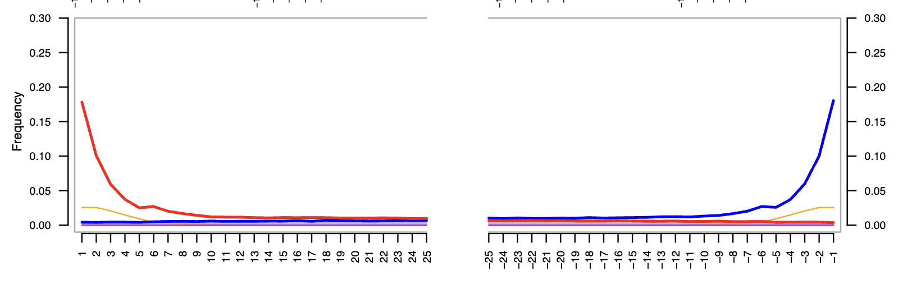

# map_and_call tutorial

This is a small tutorial on how to use my nextflow pipeline map_and_call to process, map and call WGS data.

I'll also include some tutorials on what we can do with the actual output of the pipeline.

## Get started

First off, clone this repo and download the data:

```bash
    # navigate to a folder in which you want to download the tutorial
    cd /path/to/folder # change this path to someplace where you want to store and run the tutorial, for example a dedicated directory in your project folder.
    
    # clone the tutorial repository, and enter it
    git clone https://github.com/axeljen/mapcall_tutorial
    cd map_and_call_tutorial
```

When that's done, you should have the tutorial repository cloned and the data downloaded, and we're ready to start.

## Download the data

The data we'll use in this tutorial is a small simulated set of a reference genome and WGS, illumina-like paired-end reads for 50 individuals from 5 populations (PopA-PopE). The data is hosted publicly available on osf, and can be downloaded with the following command:

```bash

    # download the archived data folder
    curl -L https://osf.io/download/fn2gc/ -o data.tar

    # and extract the data
    tar -xf data.tar

    # now we can remove the archive to save space and keep the folder clean
    rm data.tar

    # inspect the structure of the data dir, we can use tree, a tool to visualize the directory structure, for this purpose
    ml tree # tree isn't in path by default on dardel,  so we need to load it as a module

    tree data

```

A bit messy, but we can see that the data folder contains the subfolders reads and reference, where the reads folder contains the paired-end sequencing data files (two files per sample), and the reference folder contains the reference genome (reference_genome.fa.gz). This is all the data we need to run the pipeline.

## Run map_and_call

First thing we need to do is to clone the latest version of map_and_call from github. Let's do that:

```bash
    # ensure that you're located in the tutorial folder:
    pwd
    # this should show the path to the tutorial folder, e.g. /path/to/folder/map_and_call_tutorial, otherwise first navigate to the tutorial folder
    
    # next, we clone the nextflow pipeline from github
    git clone https://github.com/axeljen/map_and_call

```

The map_and_call repo should contain the following files and directories (double check with:)

```bash
    ls -1 map_and_call
```

    bin
    entry_points
    lib
    main.nf
    modules
    nextflow.config
    README.md
    run_locally.sh
    run_on_arrhenius.sh
    run_on_dardel.sh
    run_on_pelle.sh
    sample_sheet.csv
    subworkflows

Depending on what infrastructure you are running this pipeline on, you may be able to use one of the preconfigured slurm scripts (run_on_*.sh). If you're not on slurm, you can use the run_locally.sh script. If you're on a different slurm cluster than these, you should be able to adapt one of the ready-made slurm scripts for your needs: the relevant changes that you'll need to adapt are:
- Slurm headers (i.e., #SBATCH lines), as these may differ between clusters. Specifically the partition (-p) and the account (-A) lines will very likely differ

- The module load lines, as these will depend on what modules are available on your cluster. You can check which modules are available by running `module avail` on your cluster. If you'd rather (or need to) install the dependencies yourself, then you need to install [nextflow](https://www.nextflow.io/) and [conda](https://docs.conda.io/en/latest/miniconda.html) amd make sure that these are accessible in your PATH.

For the rest of this tutorial, we'll assume that you're working on dardel, and modify the run_on_dardel.sh script to suite our needs.

### Prepare the sample sheet

The sample sheet is the most important input to the pipeline (along with the reference genome), and likely the most tedious part to prepare. It must contain five columns separated by semi-colon, and the first line should be the header. You may have noticed above that there's a sample sheet included in the repository that we just cloned. It's empty with only the header line, so we can use that as a template. 

Let's copy it into our current directory, and give it a name that indicates that it's not simply the template:

```bash
    cp map_and_call/sample_sheet.csv sample_sheet_tutorial.csv
```

Since we've downloaded all the data into the data/ directory, we could manually parse through each read pair and add the relevant information to the sample sheet by hand. This is likely to be necessary in some cases, but to avoid typoes, sample mixups etc., it's always good to automate wherever possible! So for the sake of learning, we'll generate the sample sheet lines with some bash scripting:

``` bash
    # check filenames of the reads:
    find data/reads

```

An example of a read pair name is:
    P45122_1040_S470_L007_R1_001.fastq.gz, P45122_1040_S470_L007_R2_001.fastq.gz
This naming convention is copied from what the files usually looks like when we get deliveries from our sequencing facility, at least SciLife lab in Sweden currently names their files like this.
Essentially, it contains most of the relevant information we need to populate the sample sheet. The only addition we need is a user specified sample name, identifying each **individual** in the data set. The names from scilife are structured in the following way:
<Project_ID>_<Library_ID>_<demulitplexing-Library_ID>_<Flowcell_lane>_<Read_number>_<Chunk_number>.fastq.gz

Note that the sample unit in the eyes of the sequencing facility is the library which is marked by individual indices. So we need some kind of map between the user-specified sample names and the reads/library IDs.

In this tutorial, such an example is given in data/sample_metadata.txt. This file contains six columns per library: sample_id, population, data_type, library_number, read1, read2

The columns that we need for the sample sheet are:

    1) Sample name. We'll pick this from the sample metadata table.
    2) Library id. We need to differentiate by samples sequenced from several libraries, and those where the same library was sequenced on different lanes. We'll extract that from the read file name.
    3) Data type: 1 = modern, 2 = museum/historical data. We'll use the information in column three in the sample metadata table for this.
    4) read 1; this is the path to the read 1 file. We can either specify this as the full relative path (i.e., column five in the sample metadata table), or just the file basename (i.e., P45122_1081_S511_L006_R2_001.fastq.gz) and provide the --reads_dir data/reads argument to the pipeline. We'll do the latter, as this keeps the sample sheet a little cleaner.
    5) read 2; this is the path to the read 2 file, and the same rules apply as for read 1.


```bash
    # loop through each row in the sample sheet, and extract all the relevant info
    while read sample pop datatype lib read1 read2
        do
            # extract the library ID from the read 1 file name
            lib=$(basename $read1 | cut -d "_" -f 1-2) # first two fields when splitting the read 1 file name by underscores will give us a unique library ID
            # and set datatype 1 (modern) or 2 (historical)
            if [ "$datatype" == "modern" ]; then
                datatype=1
            else
                datatype=2
            fi
            # add a line to the sample sheet
            echo -e "$sample\t$lib\t$datatype\t$(basename $read1)\t$(basename $read2)" >> sample_sheet_tutorial.csv
        done < data/sample_metadata.txt

    # now before this will work, we also need to make all the reads accessible from the base of a reads_dir, which we will pass as an argument to map_and_call.
    # instead of moving or copying the files, the easieast and cleanest approach is to create symbolic links to the files in a separate directory. Symbolic links are like shortcuts to the original files, and they allow us to access the files from a different location without duplicating them.
    mkdir -p readlinks
    for read in $(find data/reads -name "*.fastq.gz")
    do
    # note that we need to link the full path to the read not to lose the connection to the files
        ln -s $(readlink -f $read) readlinks/$(basename $read)
    done

    # make sure that the sample sheet looks correct:
    head sample_sheet_tutorial.csv

```

This prints the first 10 lines of the sample sheet, and should look like this: if all went well

    sample_id       library data_type       read_1  read_2
    ind10   P45122_1020     modern  P45122_1020_S450_L006_R1_001.fastq.gz   P45122_1020_S450_L006_R2_001.fastq.gz
    ind10   P45122_1020     modern  P45122_1020_S450_L007_R1_001.fastq.gz   P45122_1020_S450_L007_R2_001.fastq.gz
    ind11   P45122_1021     historical      P45122_1021_S451_L006_R1_001.fastq.gz   P45122_1021_S451_L006_R2_001.fastq.gz
    ind12   P45122_1022     historical      P45122_1022_S452_L006_R1_001.fastq.gz   P45122_1022_S452_L006_R2_001.fastq.gz
    ind13   P45122_1023     modern  P45122_1023_S453_L006_R1_001.fastq.gz   P45122_1023_S453_L006_R2_001.fastq.gz
    ind13   P45122_1024     modern  P45122_1024_S454_L006_R1_001.fastq.gz   P45122_1024_S454_L006_R2_001.fastq.gz
    ind14   P45122_1025     modern  P45122_1025_S455_L006_R1_001.fastq.gz   P45122_1025_S455_L006_R2_001.fastq.gz
    ind15   P45122_1026     modern  P45122_1026_S456_L006_R1_001.fastq.gz   P45122_1026_S456_L006_R2_001.fastq.gz

That's all for the sample sheet!

### Prepare the slurm script

The main nextflow script is called main.nf, and when we run this with one of the default slurm profiles (in this case the dardel profile), this process will submit all of the different processes as independent slurm jobs. We could, in principle, run the main process directly in an interactive terminal, but since the pipeline takes a while to run, we'd need to make sure that the terminal session lives to see the end of the pipeline, else it will fail. A better approach is to submit the main process itself as a slurm job, and this is what we'll do through one of the preconfigured slurm scripts.

Let's copy the run_on_dardel.sh script into our current directory, and start preparing it for our needs:

```bash
    cp map_and_call/run_on_dardel.sh run_on_dardel_tutorial.sh

    # inspect the content
    cat run_on_dardel_tutorial.sh
```

As you'll see, there are a bunch of things we need to change in there. If you're working on for example vscode where you can edit the script directly in a text editor, you can just go ahead and make the changes manually. But again, for the sake of practicing bash, I'll take you through the possibiltiy of editing this script entirely through the command line:

```bash
    # we'll use the sed command (stream editor) to make the changes in the script. With the -i flag, we can edit the file in place.

    # first thing to set is the slurm account, as this is specified by the placeholder <NAISS_COMPUTE_PROJECT> in the slurm script. I will be using the account naiss2026-4-730 here, but you need to use an account that you're a part of and that's allowed to run jobs on dardel (or whichever cluster you're using).
    account_to_use=naiss2026-4-730 #edit this line, as it defines a variable with the account to use, and we'll just reference the variable in the next line.
    sed -i "s/<NAISS_COMPUTE_PROJECT>/$account_to_use/g" run_on_dardel_tutorial.sh
    # next, we need to set the path to the sample sheet, by replacing the placeholder 'path/to/input.csv' with the path to the sample sheet that we just created. Since it's in the current directory, we can just use the name of the file. To let sed know that the slashes in the path are not to be interpreted as delimiters, we need to use "escape" characters (backslashes) before each slash in the path. 
    sed -i "s/\/path\/to\/input.csv/sample_sheet_tutorial.csv/g" run_on_dardel_tutorial.sh

    # next the reference genome, which is located at data/reference/reference_genome.fa.gz, and placeheld in the template by '/path/to/reference_genome.fa':
    sed -i "s/\/path\/to\/reference_genome.fa/data\/reference\/reference_genome.fa.gz/g" run_on_dardel_tutorial.sh

    # the argument we mentioned before, namely the directory where all our reads are stored:
    sed -i "s/\/path\/to\/reads_directory/data\/readlinks/g" run_on_dardel_tutorial.sh

    # an optional argument to the pipeline is the scaffold_list, which is a simple text file just listing the scaffolds or chromosomes in the reference genome that we want to perform variant calling on.
    # since this is a small simulated genome, we will include all scaffolds, and in principle we could then just omit this option. But we can also prepare a list of all chromosomes in the reference genome, and just pass this one:
    zcat data/reference/reference_genome.fa.gz | grep ">" | sed 's/>//g' > data/reference/scaffold_list.txt
    
    # now:
    cat data/reference/scaffold_list.txt
    # should give you a list of all chromosomes in the simulated genome, chr1-chr10
    # let's replace the placeholder in the slurm script with the path to this file:
    sed -i "s/\/path\/to\/scaffolds.txt/data\/reference\/scaffold_list.txt/g" run_on_dardel_tutorial.sh

    # let's set a path to where we want to store the output of the pipeline, too:
    sed -i "s/\/path\/to\/output_directory/output_tutorial/g" run_on_dardel_tutorial.sh

    # now one final thing. Since we'll be executing the pipeline from this directory, not from the actual map_and_call folder, we need to adjust the path to the main.nf script in the slurm script, so the computer knows where to find the main script:
    sed -i "s/main.nf/map_and_call\/main.nf/g" run_on_dardel_tutorial.sh

    # double check that all our changes came through:
    cat run_on_dardel_tutorial.sh

    # if all looks correct, we're ready to ship the job to slurm!
    sbatch run_on_dardel_tutorial.sh

while read sample pop datatype lib read1 read2
do
if [[ !  -f "$read1" && ! -f "$read2" ]]
then
echo "Missing reads for $sample, $lib: $read1 $read2"
fi
done < sample_metadata.txt

```
Slurm jobs will log progress in two files, one for stdout and one for stderr. We've specified the location of these files in the slurm headers of our script:
    
    #SBATCH -o ./logs/%x-%j.out
    #SBATCH -e ./logs/%x-%j.error

The .out is stdout and .error is stderr. The %x and %j are placeholders that automatically will expand to the job name and job id, respectively. So for example, if the job name is map-and-call, as it will be in this case unless you've changed the slurm header for the job name (\#SBATCH -J map-and-call), the stdout file will be called map-and-call-<job_id>.out, and the stderr file will be called map-and-call-<job_id>.error. The jobid is automatically assigned by slurm upon submission, and will be unique for each job. Note that we place these files in a separate, child directory, logs/. This is just for the purpose of keeping the directory a bit cleaner, and the logs directory will be automatically created by slurm if it doesn't already exist.

To quickly monitor the progress of the pipeline, we can check running/queued slurm jobs with:

    ```bash
    squeue -u $USER
    ```
    
    Don't be scared if this shows tons of jobs, the pipeline spawns a lot of independent jobs, like processing of each individual read pair and whatnot, so that's normal. For more detailed information about the progress, we can have a look in the stdout file:

    ```bash
    # find the most recent stdout file in the logs directory:
    ls -1tr logs/*.out | tail -n 1 # the following flags were added to ls here: -1 = list one file per line, -t = sort by modification time, -r = reverse order (so the most recent file is last). Typing this as ls -1 -t -r is equivalent to ls -1tr

    # Nextflow stdout becomes a bit messy when written to a file like this, but a neat thing we can do is to monitor the last part of the file in real time, with less:
    less +F $(ls -1tr logs/*.out | tail -n 1)
    
    ```

A snapshot of this less output can look like this:
    
    executor >  slurm (152)
    [34/520f07] IND…x (reference_genome.fa.gz) | 1 of 1 ✔
    [af/5c1df4] IND…x (reference_genome.fa.gz) | 1 of 1 ✔
    [34/3c1c2c] IND…CE:dochunks (refintervals) | 1 of 1 ✔
    [0b/42e364] PRE…RN:fastqc_rawreads (ind37) | 50 of 50 ✔
    [88/c65381] PRE…SS_MODERN:multiqc_rawreads | 1 of 1 ✔
    [e3/785caf] PRE…OCESS_MODERN:fastp (ind35) | 50 of 50 ✔
    [-        ] PREPROCESS_MODERN:concat_reads -
    [64/08cacb] PRE…RN:clumpify_paired (ind29) | 50 of 50 ✔
    [de/81e05c] PRE…:fastqc_cleanreads (ind41) | 39 of 50
    [-        ] PRE…_MODERN:multiqc_cleanreads -
    [-        ] PRE…HISTORICAL:fastqc_rawreads -
    [-        ] PRE…ISTORICAL:multiqc_rawreads -
    [-        ] PRE…_HISTORICAL:adapterremoval -
    [-        ] PRE…SS_HISTORICAL:concat_reads -
    [-        ] PRE…ISTORICAL:concat_collapsed -
    [-        ] PRE…HISTORICAL:clumpify_paired -
    [-        ] PRE…HISTORICAL:clumpify_single -
    [-        ] PRE…STORICAL:fastqc_cleanreads -
    [-        ] PRE…TORICAL:multiqc_cleanreads -
    [09/cb930c] MAP_MODERN:bwa_mem (ind7)      | 26 of 50

Here you can follow the progress of the pipeline: Some of the processes only run once and are already finished, for example:

    [34/520f07] IND…x (reference_genome.fa.gz) | 1 of 1, cached: 1 ✔

The text is unfortunately truncated here, but this process is the indexing of the reference genome – which only has to be done once, prior to mapping, and for this relatively small simulated genome it's rather quick so in this case it's already finished. 

Other processes run once per sample, e.g.,:

    [e3/785caf] PRE…OCESS_MODERN:fastp (ind35) | 50 of 50 ✔

This is the trimming/cleaning of the read files with the program fastp, and the 50 of 50 means that this process was scheduled to run 50 times, once for each sample in our sample sheet. The check mark at the end indicates that this process is already finished for all samples. 

As the pipeline progresses, you may see other numbers here too, as some processes will parallelize across genomic regions etc., so the scheduled number of times they run may vary.

As nextflow executes the pipeline, it will write all the intermeditate files that each of the processes create into a dedicated directory. This is called the workdir, and by default it will be located in the folder where we execute the pipeline from. So if you do:


    ls -1

You should now see that a directory named "work" has been created. 

This folder can become very large when the pipeline is applied to real datasets, which can potentially cause problems if there's limited storage space on the project directory where the pipeline is run. If there is a temporary/scratch storage system available on the cluster where you're running the pipeline, it may therefore be a good idea to tell nextflow to use the temporary storage for this directory. Note that the tempstorage need to be accessible to across compute nodes, so we cannot use node-specific scratch storage which is the only thing available on some slurm clusters (Uppmax, for example). On dardel, however, we can accomplish this by adding the following flag to the pipeline execution inside the slurm script:


    -work-dir $PDC_TMP/map_and_call_workdir

Once everything is finished, you should see the `output_tutorial` directory populated with the results from the pipeline.

Let's have a look at this directory:

```bash
tree -L 1 output_tutorial 
```

    output_tutorial
    ├── 00_input_data
    ├── 01_reports
    ├── 02_bamfiles
    ├── 03_genotypes
    └── pipeline_info

    6 directories, 0 files

The content of these folders are documented on the main [map_and_call github repository](https://github.com/axeljen/map_and_call). Briefly, the 00_input_data contains the indexed reference genome, the 01_reports folder contains various quality control and summary reports, the 02_bamfiles folder contains the aligned reads in BAM – or if --store_crams were used when running the pipeline, as in this case, CRAM format (CRAM is just one extra layer of compression on a BAM file). The 03_genotypes folder contains the called variants in VCF format, both raw and "filtered" – note that this is a rather rough filtering and that extra filters might need to be applied downstream, too.

In the reports folder, there is a file containing a bunch of summary statistics, which can be a good starter to look at to see if anything stands out:

### `summary_statistics.tsv`

| sample_id | population | sex_assignment | bam_depth_autosomes | bam_depth_non_sex_limited | bam_depth_sex_limited | ratio_non_sex_limited_to_autosomes | downsampled_bam_depth_autosomes | downsampled_bam_depth_non_sex_limited | downsampled_bam_depth_sex_limited | callable_sites | num_snps | num_missing_snps | heterozygosity |
| --- | --- | --- | --- | --- | --- | --- | --- | --- | --- | --- | --- | --- | --- |
| ind21 | ind21 | unknown | 2.96362 | 0.0 | 0.0 | 0.0 | NA | NA | NA | 8704195 | 164642 | 21872 | 0.000670 |
| ind10 | ind10 | unknown | 14.99732 | 0.0 | 0.0 | 0.0 | NA | NA | NA | 9985273 | 164642 | 1017 | 0.000493 |
| ind12 | ind12 | unknown | 2.96549 | 0.0 | 0.0 | 0.0 | NA | NA | NA | 8708761 | 164642 | 21818 | 0.000477 |
| ind11 | ind11 | unknown | 2.965949 | 0.0 | 0.0 | 0.0 | NA | NA | NA | 8692826 | 164642 | 21944 | 0.000472 |
| ind18 | ind18 | unknown | 14.99738 | 0.0 | 0.0 | 0.0 | NA | NA | NA | 9985280 | 164642 | 914 | 0.000434 |
| ind13 | ind13 | unknown | 14.9973 | 0.0 | 0.0 | 0.0 | NA | NA | NA | 9986270 | 164642 | 1001 | 0.000449 |
| ind1 | ind1 | unknown | 2.967058 | 0.0 | 0.0 | 0.0 | NA | NA | NA | 8703264 | 164642 | 21883 | 0.000475 |
| ind16 | ind16 | unknown | 14.99764 | 0.0 | 0.0 | 0.0 | NA | NA | NA | 9983866 | 164642 | 1007 | 0.000429 |
| ind19 | ind19 | unknown | 14.99743 | 0.0 | 0.0 | 0.0 | NA | NA | NA | 9983642 | 164642 | 1007 | 0.000414 |
| ind25 | ind25 | unknown | 14.99728 | 0.0 | 0.0 | 0.0 | NA | NA | NA | 9986061 | 164642 | 1380 | 0.000724 |
| ind22 | ind22 | unknown | 2.965445 | 0.0 | 0.0 | 0.0 | NA | NA | NA | 8710841 | 164642 | 21972 | 0.000635 |
| ind23 | ind23 | unknown | 14.99747 | 0.0 | 0.0 | 0.0 | NA | NA | NA | 9984543 | 164642 | 1206 | 0.000707 |
| ind17 | ind17 | unknown | 14.99708 | 0.0 | 0.0 | 0.0 | NA | NA | NA | 9984468 | 164642 | 1063 | 0.000428 |
| ind2 | ind2 | unknown | 2.964723 | 0.0 | 0.0 | 0.0 | NA | NA | NA | 8698519 | 164642 | 22091 | 0.000487 |
| ind30 | ind30 | unknown | 14.99742 | 0.0 | 0.0 | 0.0 | NA | NA | NA | 9984418 | 164642 | 1232 | 0.000658 |
| ind32 | ind32 | unknown | 2.965838 | 0.0 | 0.0 | 0.0 | NA | NA | NA | 8702577 | 164642 | 22016 | 0.000519 |
| ind24 | ind24 | unknown | 14.9977 | 0.0 | 0.0 | 0.0 | NA | NA | NA | 9984449 | 164642 | 1395 | 0.000783 |
| ind36 | ind36 | unknown | 14.99735 | 0.0 | 0.0 | 0.0 | NA | NA | NA | 9984729 | 164642 | 1100 | 0.000547 |
| ind35 | ind35 | unknown | 14.99758 | 0.0 | 0.0 | 0.0 | NA | NA | NA | 9985286 | 164642 | 1143 | 0.000550 |
| ind33 | ind33 | unknown | 14.99757 | 0.0 | 0.0 | 0.0 | NA | NA | NA | 9983976 | 164642 | 1118 | 0.000489 |
| ind39 | ind39 | unknown | 14.99717 | 0.0 | 0.0 | 0.0 | NA | NA | NA | 9984436 | 164642 | 1190 | 0.000536 |
| ind4 | ind4 | unknown | 14.99765 | 0.0 | 0.0 | 0.0 | NA | NA | NA | 9985262 | 164642 | 973 | 0.000458 |
| ind31 | ind31 | unknown | 2.965792 | 0.0 | 0.0 | 0.0 | NA | NA | NA | 8705234 | 164642 | 21901 | 0.000551 |
| ind26 | ind26 | unknown | 14.9975 | 0.0 | 0.0 | 0.0 | NA | NA | NA | 9984836 | 164642 | 1387 | 0.000760 |
| ind40 | ind40 | unknown | 14.99712 | 0.0 | 0.0 | 0.0 | NA | NA | NA | 9985198 | 164642 | 973 | 0.000517 |
| ind7 | ind7 | unknown | 2.965083 | 0.0 | 0.0 | 0.0 | NA | NA | NA | 8697835 | 164642 | 21840 | 0.000473 |
| ind8 | ind8 | unknown | 14.99737 | 0.0 | 0.0 | 0.0 | NA | NA | NA | 9984214 | 164642 | 905 | 0.000431 |
| ind42 | ind42 | unknown | 14.99736 | 0.0 | 0.0 | 0.0 | NA | NA | NA | 9985449 | 164642 | 302 | 0.000425 |
| ind41 | ind41 | unknown | 14.99796 | 0.0 | 0.0 | 0.0 | NA | NA | NA | 9985814 | 164642 | 272 | 0.000405 |
| ind34 | ind34 | unknown | 14.99738 | 0.0 | 0.0 | 0.0 | NA | NA | NA | 9983585 | 164642 | 1058 | 0.000515 |
| ind15 | ind15 | unknown | 14.99747 | 0.0 | 0.0 | 0.0 | NA | NA | NA | 9984039 | 164642 | 991 | 0.000382 |
| ind29 | ind29 | unknown | 14.99711 | 0.0 | 0.0 | 0.0 | NA | NA | NA | 9985741 | 164642 | 1354 | 0.000723 |
| ind14 | ind14 | unknown | 14.99687 | 0.0 | 0.0 | 0.0 | NA | NA | NA | 9984457 | 164642 | 884 | 0.000374 |
| ind3 | ind3 | unknown | 14.99755 | 0.0 | 0.0 | 0.0 | NA | NA | NA | 9985028 | 164642 | 939 | 0.000457 |
| ind37 | ind37 | unknown | 14.99716 | 0.0 | 0.0 | 0.0 | NA | NA | NA | 9985468 | 164642 | 1114 | 0.000526 |
| ind38 | ind38 | unknown | 14.99791 | 0.0 | 0.0 | 0.0 | NA | NA | NA | 9984120 | 164642 | 1094 | 0.000561 |
| ind28 | ind28 | unknown | 14.99774 | 0.0 | 0.0 | 0.0 | NA | NA | NA | 9985511 | 164642 | 1141 | 0.000589 |
| ind27 | ind27 | unknown | 14.99758 | 0.0 | 0.0 | 0.0 | NA | NA | NA | 9984359 | 164642 | 1406 | 0.000716 |
| ind5 | ind5 | unknown | 14.99754 | 0.0 | 0.0 | 0.0 | NA | NA | NA | 9985372 | 164642 | 887 | 0.000441 |
| ind6 | ind6 | unknown | 2.967339 | 0.0 | 0.0 | 0.0 | NA | NA | NA | 8706445 | 164642 | 21727 | 0.000506 |
| ind9 | ind9 | unknown | 14.99715 | 0.0 | 0.0 | 0.0 | NA | NA | NA | 9985781 | 164642 | 1036 | 0.000490 |
| ind20 | ind20 | unknown | 14.99758 | 0.0 | 0.0 | 0.0 | NA | NA | NA | 9984727 | 164642 | 1048 | 0.000441 |

This table contains one row per sample, with population assignment (in this case, it will be identical to the sample since by default this is how the samples are treated by map_and_call if nothing else is specified). It also contains sex assignment which is also redundant here, since we didn't specify any sex chromosomes when running the pipeline. The next field, bam_depth_autosomes, is more relevant. This is the average mapping depth per sample across all "autosomes" (in this case, all chromosomes). As you can see, our "modern" samples are around ~15x of coverage depth, while the "historical" samples have much shallower sequencing depth around 3x. In a real dataset, these values would likely be much more variable across samples than we see in this simulated data set.

Then there is a bunch of for this dataset irrelevant columns again, until we get to the column callable sites and onwards. Callable sites equals the total number of positions in the genome where we, with the default settings in map_and_call, get sufficiently deep mapping to trust that we can confidently determine the genotype on this site. The simulated genome size here is 10Mb, so the modern samples were callable across ~99% of the genome, whereas the historical ones only on ~87%. 

This is reflected also in the number of missing SNPs, where the historical samples have much more missing data.

While there are ways to accomodate for variation in coverage and missingness in downstream analyses, we could also partly control for this already in the map_and_call pipeline. By adding the flag --downsample_bams, we can instruct the pipeline to randomly downsample all the bamfiles in the dataset to a specified mapping depth. Either, we specify a target depth with --downsample_bams_coverage <INT>, or we could just use --downsample_bams and the pipeline will downsample everything to a target depth equal to the sample with the lowest coverage in the dataset.

Let's rerun the pipeline with --downsample_bams enabled – this will be fairly quick since the pipeline can reuse all the mapped bam files, so it will only do the downsampling, genotyping and filtering again.

Make a copy of the previous slurm script:
```bash
cp run_on_dardel_tutorial.sh run_on_dardel_tutorial_dsbams.sh
```

And edit this new file to include the --downsample_bams argument, and add a separate output path so we can later on compare the output too. So make sure that:
    OUTDIR='output_tutorial_dsbams'
and the actual command is:
    nextflow run map_and_call/main.nf \
        -profile 'dardel' \
        -resume \
        --input "$INPUT_CSV" \
        --reference "$REFERENCE" \
        --reads_dir "$READS_DIR" \
        --scaffold_list "$SCAFFOLD_LIST" \
        --outdir "$OUTDIR" \
        --slurm_account "$SLURM_JOB_ACCOUNT" \
        --variant_caller "$VARIANT_CALLER" \
        --with_singularity \
        --chunk_size "$CHUNK_SIZE" \
        --downsample_bams
and then rerun:
    sbatch run_on_dardel_tutorial_dsbams.sh

    
Once this finishes, let's look at the summary table out of this one:

### `output_tutorial_dsbams/01_reports/summary_statistics.tsv`

| sample_id | population | sex_assignment | bam_depth_autosomes | bam_depth_non_sex_limited | bam_depth_sex_limited | ratio_non_sex_limited_to_autosomes | downsampled_bam_depth_autosomes | downsampled_bam_depth_non_sex_limited | downsampled_bam_depth_sex_limited | callable_sites | num_snps | num_missing_snps | heterozygosity |
| --- | --- | --- | --- | --- | --- | --- | --- | --- | --- | --- | --- | --- | --- |
| ind18 | ind18 | NA | 14.99738 | NA | NA | NA | 2.952805 | NA | NA | 8682843 | 148473 | 19742 | 0.000237 |
| ind20 | ind20 | NA | 14.99758 | NA | NA | NA | 2.958271 | NA | NA | 8671166 | 148473 | 20110 | 0.000240 |
| ind12 | ind12 | NA | 2.96549 | NA | NA | NA | 2.963681 | NA | NA | 8709638 | 148473 | 19660 | 0.000457 |
| ind11 | ind11 | NA | 2.965949 | NA | NA | NA | 2.963739 | NA | NA | 8694001 | 148473 | 19784 | 0.000454 |
| ind14 | ind14 | NA | 14.99687 | NA | NA | NA | 2.957663 | NA | NA | 8679685 | 148473 | 19995 | 0.000204 |
| ind13 | ind13 | NA | 14.9973 | NA | NA | NA | 2.966635 | NA | NA | 8678823 | 148473 | 19905 | 0.000255 |
| ind1 | ind1 | NA | 2.967058 | NA | NA | NA | 2.963644 | NA | NA | 8704492 | 148473 | 19741 | 0.000455 |
| ind10 | ind10 | NA | 14.99732 | NA | NA | NA | 2.95053 | NA | NA | 8691577 | 148473 | 19624 | 0.000272 |
| ind2 | ind2 | NA | 2.964723 | NA | NA | NA | 2.963625 | NA | NA | 8698912 | 148473 | 19884 | 0.000466 |
| ind15 | ind15 | NA | 14.99747 | NA | NA | NA | 2.974527 | NA | NA | 8683471 | 148473 | 19841 | 0.000220 |
| ind19 | ind19 | NA | 14.99743 | NA | NA | NA | 2.972103 | NA | NA | 8678034 | 148473 | 20044 | 0.000221 |
| ind3 | ind3 | NA | 14.99755 | NA | NA | NA | 2.95293 | NA | NA | 8686580 | 148473 | 19831 | 0.000258 |
| ind16 | ind16 | NA | 14.99764 | NA | NA | NA | 2.954692 | NA | NA | 8692213 | 148473 | 19823 | 0.000242 |
| ind30 | ind30 | NA | 14.99742 | NA | NA | NA | 2.962957 | NA | NA | 8693291 | 148473 | 19805 | 0.000368 |
| ind24 | ind24 | NA | 14.9977 | NA | NA | NA | 2.967241 | NA | NA | 8681885 | 148473 | 20140 | 0.000454 |
| ind26 | ind26 | NA | 14.9975 | NA | NA | NA | 2.954602 | NA | NA | 8689854 | 148473 | 20044 | 0.000429 |
| ind29 | ind29 | NA | 14.99711 | NA | NA | NA | 2.956201 | NA | NA | 8677949 | 148473 | 20109 | 0.000408 |
| ind21 | ind21 | NA | 2.96362 | NA | NA | NA | 2.96362 | NA | NA | 8704195 | 148473 | 19731 | 0.000643 |
| ind35 | ind35 | NA | 14.99758 | NA | NA | NA | 2.962604 | NA | NA | 8672241 | 148473 | 20023 | 0.000301 |
| ind23 | ind23 | NA | 14.99747 | NA | NA | NA | 2.962579 | NA | NA | 8679530 | 148473 | 20202 | 0.000404 |
| ind25 | ind25 | NA | 14.99728 | NA | NA | NA | 2.964207 | NA | NA | 8676767 | 148473 | 20292 | 0.000417 |
| ind17 | ind17 | NA | 14.99708 | NA | NA | NA | 2.948386 | NA | NA | 8674680 | 148473 | 19728 | 0.000241 |
| ind38 | ind38 | NA | 14.99791 | NA | NA | NA | 2.966036 | NA | NA | 8674639 | 148473 | 20006 | 0.000297 |
| ind22 | ind22 | NA | 2.965445 | NA | NA | NA | 2.963612 | NA | NA | 8712154 | 148473 | 19836 | 0.000612 |
| ind36 | ind36 | NA | 14.99735 | NA | NA | NA | 2.946214 | NA | NA | 8677695 | 148473 | 19927 | 0.000285 |
| ind40 | ind40 | NA | 14.99712 | NA | NA | NA | 2.955836 | NA | NA | 8677559 | 148473 | 19917 | 0.000290 |
| ind5 | ind5 | NA | 14.99754 | NA | NA | NA | 2.949337 | NA | NA | 8679705 | 148473 | 19689 | 0.000237 |
| ind32 | ind32 | NA | 2.965838 | NA | NA | NA | 2.963454 | NA | NA | 8704358 | 148473 | 19817 | 0.000494 |
| ind27 | ind27 | NA | 14.99758 | NA | NA | NA | 2.951065 | NA | NA | 8692665 | 148473 | 20012 | 0.000402 |
| ind31 | ind31 | NA | 2.965792 | NA | NA | NA | 2.963655 | NA | NA | 8705976 | 148473 | 19773 | 0.000522 |
| ind34 | ind34 | NA | 14.99738 | NA | NA | NA | 2.967107 | NA | NA | 8667530 | 148473 | 20203 | 0.000278 |
| ind41 | ind41 | NA | 14.99796 | NA | NA | NA | 2.959527 | NA | NA | 8678168 | 148473 | 19506 | 0.000189 |
| ind33 | ind33 | NA | 14.99757 | NA | NA | NA | 2.958413 | NA | NA | 8709635 | 148473 | 19537 | 0.000273 |
| ind39 | ind39 | NA | 14.99717 | NA | NA | NA | 2.967898 | NA | NA | 8694724 | 148473 | 19696 | 0.000291 |
| ind28 | ind28 | NA | 14.99774 | NA | NA | NA | 2.976215 | NA | NA | 8681884 | 148473 | 20321 | 0.000328 |
| ind4 | ind4 | NA | 14.99765 | NA | NA | NA | 2.949095 | NA | NA | 8682849 | 148473 | 19634 | 0.000255 |
| ind9 | ind9 | NA | 14.99715 | NA | NA | NA | 2.981844 | NA | NA | 8664384 | 148473 | 20575 | 0.000267 |
| ind37 | ind37 | NA | 14.99716 | NA | NA | NA | 2.963866 | NA | NA | 8680245 | 148473 | 19814 | 0.000286 |
| ind8 | ind8 | NA | 14.99737 | NA | NA | NA | 2.967116 | NA | NA | 8672594 | 148473 | 20105 | 0.000242 |
| ind42 | ind42 | NA | 14.99736 | NA | NA | NA | 2.953377 | NA | NA | 8675642 | 148473 | 19568 | 0.000161 |
| ind6 | ind6 | NA | 2.967339 | NA | NA | NA | 2.963133 | NA | NA | 8708085 | 148473 | 19574 | 0.000487 |
| ind7 | ind7 | NA | 2.965083 | NA | NA | NA | 2.963528 | NA | NA | 8698247 | 148473 | 19738 | 0.000454 |

Notice the difference? All samples now have been populated with (very similar) values in the downsampled_bam_depth_autosomes column, and the missing data is now very similar across the board. This is essential to keep in mind when, for example, estimating genetic diversity and demographic history, as those values can be greatly affected by variation in sequencing depth.

Another thing to keep in mind when working with historical data, is the possibility of DNA damage due to degradation. This is, by default, assessed but not corrected for in map_and_call. Using a tool called MapDamage, we're estimating the presense of DNA damage towards the read ends (read more about this [here](https://www.spaam-community.org/little-book-of-smiley-plots/intro.html)). If damage pattern is highly prevalent, this may cause erroneous patterns in downstream analyses. 

The output from MapDamage is in the 01_reports/03_damage_profiles, containing one directory per sample marked as historical in our sample sheet:

    tree output_tutorial_dsbams/01_reports/03_damage_profiles/ind11_damage

    output_tutorial_dsbams/01_reports/03_damage_profiles/ind11_damage
    ├── Fragmisincorporation_plot.pdf
    ├── Length_plot.pdf
    ├── Stats_out_MCMC_hist.pdf
    ├── Stats_out_MCMC_post_pred.pdf
    └── Stats_out_MCMC_trace.pdf

These all contains different plots/reports form mapdamage. The most important one to check is the Fragmisincorporation_plot.pdf, as it shows the patterns of DNA damage towards the read ends. Let's look at this specific one:

    output_tutorial_dsbams/01_reports/03_damage_profiles/ind11_damage/Fragmisincorporation_plot.pdf

If you scroll down towards the end of this file, you'll see a figure looking something like this:


That particular "smiley-face" pattern, with elevated levels of C-to-T and G-to-A substitutions towards the read ends, is indicative of typical ancient DNA damage. In this case it's very much expected, since the reads were simulated to show this pattern. If you see a strong pattern like this in your own real data, it might be a good idea to run the pipeline including the --damageprofiler_rescale option enabled. With this argument, MapDamage will not only assess damage patterns, but also try to correct them. Let's add this flag, and change to a new output directory once more, and rerun the pipeline:

    cp run_on_dardel_tutorial_dsbams.sh run_on_dardel_tutorial_dsbams_rescale.sh

Change output parameter in this file:
    OUTDIR='output_tutorial_dsbams_rescaled'
And add the rescale parameter:
    nextflow run map_and_call/main.nf \
        -profile 'dardel' \
        -resume \
        --input "$INPUT_CSV" \
        --reference "$REFERENCE" \
        --reads_dir "$READS_DIR" \
        --scaffold_list "$SCAFFOLD_LIST" \
        --outdir "$OUTDIR" \
        --slurm_account "$SLURM_JOB_ACCOUNT" \
        --variant_caller "$VARIANT_CALLER" \
        --with_singularity \
        --chunk_size "$CHUNK_SIZE" \
        --downsample_bams \
        --damage_profiler_rescale

and rerun:
    sbatch run_on_dardel_tutorial_dsbams_rescale.sh